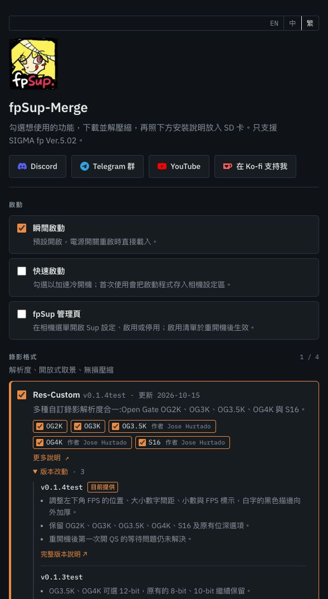

# Res-Custom v0.1.4test — 本地 Merge 更新

已將使用者確認的 combined-fix12 封裝為本地 v0.1.4test，未改寫產品位元組。

- 原始 BIN：313216 B，SHA-256 `d9a8e10050184424886afaca263279967ab2cc2c89314c44038fe4402a676355`。
- 使用 builder 預設設定，不含卡上個人 CFG；五份 RCD 與 v0.1.3test 相同。
- 本地頁面：<http://127.0.0.1:8731/tools/merge-v3/>；版本改動已列出 FPS 樣式及首次 QS 等待尚未解決。
- 匯出 `fpsup-res-custom-v0.1.4test-IS.zip` 由頁面自身 compose 程式產生，BIN／五份 RCD 逐位元組相符。瀏覽器 download event 等待逾時，因此不把它列為瀏覽器下載完成證據。
- 其他產品及開發中項目均與更新前相同，舊 v0.1.3test 全部檔案 hash 相同；預設及所有非管理頁啟動配對不變，八種 AutoRun 均不變。
- 維護中的 builder 把既有共用 applier 的字串上限修正（8 → 64，FPS 33 字串需要）帶入四種管理頁 loader 和 ALLSUPS；相關來源差異只有 ui_apply.c，見 catalogue-diff.json。沒有手工覆蓋啟動位元組。
- 合併／UI／版本歷史測試全過；boot-entry-chain 14 組建置、3 個 AutoRun 比較、8 個 refs 通過。共用啟動及管理頁測試、applier 測試均完成，無 skipped；數量與來源記於 release/validation.json。
- 原始受限環境 JIT 測試 exit 132；允許離線 JIT 後重跑成功。沒有相機 I/O、寫卡、錄影、commit、push 或公開發布。

本次不清理 280 fps 殘留，也沒有新的效能量測；已驗收的相機外觀範圍仍以 run7 為準。

