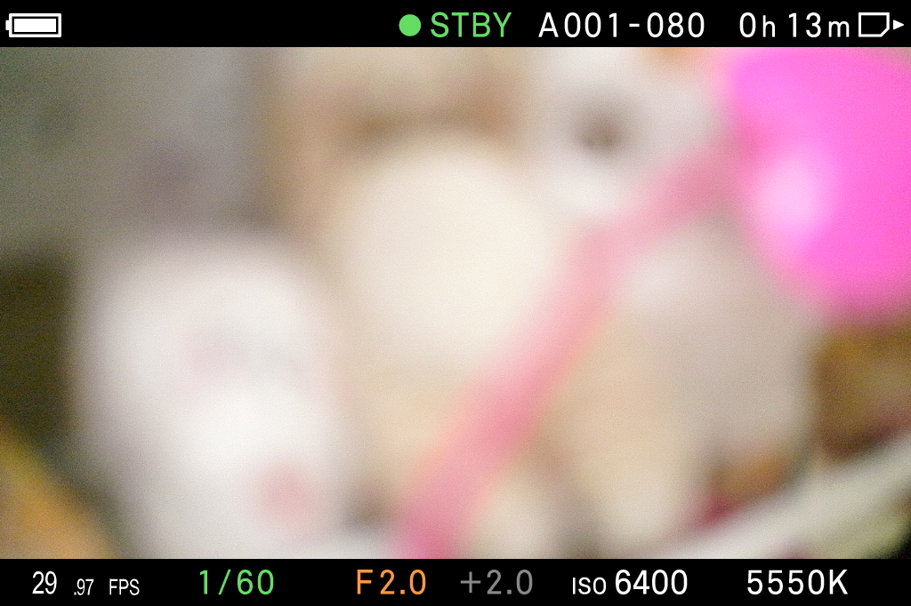

# FPS 更新後續測與黑色描邊 — 2026-10-15

> 後續已部署縮小整數／小數空隙的 fix10，最新狀態見 [run5](../run5/RESULTS.md)。下面的「目前卡上」描述本階段 fix9 的歷史狀態。

目前卡上為 **combined-fix9**。先開關 QS，確認活動畫面回到 `LV_CINE_MEDIUM`，1931 及原廠對照後還原的最新 1939 均可見完整 **29.97 FPS**。1939 的其他原廠底部資訊未出現，不能稱整條資訊列皆通過。白字周圍使用四個對角各一像素的黑字副本形成描邊；整數、小數、FPS 的白字最後解析。字形與間距仍和原廠參考有差異，**尚未驗收為原廠一致**。

首次 QS 等待問題未解決。最後正式數據為 fix4 的 6.1161 s；本輪 fix8／fix9 沒有重新做首次效能量測，不能把該數字寫成最新版本的測速。

## 更正舊判定

使用者指出 1910 是尚未開關 QS 的舊畫面。重新更新後，1911 顯示新文字較窄、間距過大、沒有描邊。1910／1904 白字遮罩相同的計算，以及其後取得的元件樹，均不能證明較早照片已由新程式繪出。先前「59.94 與原廠一致」的判定撤回；首頁與狀態索引已更正。

## 描邊與字體試驗

| 候選 | 更新後實機觀察 | 結果 |
|---|---|---|
| fix5 | Latin 字體加原生 outline 屬性；正常 FPS 缺失、出現極小異色字形 | 未採用 |
| fix6／mode0 | 移除 Latin override，再測原生 outline mode 1／0；屬性可讀回，實際畫面仍失敗 | 未採用 |
| fix7 | 改成獨立 sibling 物件仍失敗 | 未採用 |
| fix8 | 保留原物件，以 12 個黑字副本＋3 個白字繪製；1923 對比色控制可見白字外緣 | 描邊方法成立 |
| fix9 | 同一副本方法，單獨加入 `Other_fontsetting`，未加入原生 outline 屬性；1927、1931 完整白字可見 | 目前卡上版本，字形仍偏窄 |

原生 outline 的失敗原因尚未確認，不能據此斷言是字體、同物件限制或 renderer 不支援。fix5 同時改字體與 outline，無法單獨判斷；fix9 隔離字體後沒有再出現該異色字形，但也未明顯消除原廠字形差異。

fix8 對比色證據為 `edge-colour-proof/1923-20261015-fps-edge-colour-control-B.jpg`，只暫改自有 RAM 記錄的黑字顏色，未改卡。`edge-colour-restored-black.json` 完整讀回還原黑色記錄。其後 1924／1925 的整條底部資訊列未出現，**不能用這兩張宣稱黑色實拍通過**。

fix9 的相同 RAM 對比色試驗中，1928／1929 也未出現整條底列，屬於無法判定的對比色照片。不能把這次照片寫成外緣實拍成功。色彩已完整還原（`fix9-edge-colour-restored-black.json`，64152 B 全表比對）；再開關 QS 後 1930／1931 完整顯示白色 FPS 和其他原廠底部資訊。重複一次 QS，1932／1933 又出現整條底列缺失。

為區分此現象，完整備份並暫時移除單一 RES-Custom BIN，重新啟動；確認卡檔缺席、picker hook 與中尺寸 FrameRate draw 記錄均已還原原廠。相同 QS 序列的原廠對照中，1935 完整顯示原廠 `29.97 FPS`，再次 QS 後 1937 也缺少整條底列。因此這個現象不是新版文字獨有，尚未區分實體顯示、原廠狀態切換或截圖流程的來源。原廠對照保留其他模組，不能稱為純原廠韌體測試。證據在 `stock-footer-first-QS/`、`stock-footer-repeat-QS/`。

對照後已精確還原 250880 B 的 fix9 卡檔並整檔讀回，見 `footer-stock-control/card-state.json`（`restored_exact`）與 `restored.BIN`。沒有錄影或以錄影狀態驗收。

## 實際成品與設定保存

- Builder BIN：`../combined-fix9/32RESCUS.BIN`，250880 B，SHA-256 `869c5f2ee925497c9f829356e68c01c307822b4c82e1e43956a7cdedcd2601e0`。
- 實際卡檔：`../prepared-combined-fix9-32RESCUS.BIN`，SHA-256 `9036933232b9cf8952ae6eb75b94ba60fa55965daacccaba08b0d9f5c09dce2b`；完整遠端讀回相符，見 `../deployment-combined-fix9.json`。
- CFG bytes 32..128 保留，SHA-256 `be62abbe2254b1c884c280a4352039f677bf7128bd81eea87dfb30990e855640`。
- 沿用目前卡的 AutoRun、loader 程式與其他模組。五個標準 RCD 不變；未改相機格率，本輪實際為使用者目前的 29.97。
- `restored-final-state.json`（原廠對照後最終重啟）：執行中 immutable code 相符，VR_UI=1、VR_WHY=1；十一個模組均 loaded／enabled，SupManager status=0、write_error=0。最後非錄影待機，echo 與 GUI 診斷旗標還原；唯一 socket owner PID 43398。

## 離線檢查與界限

十五個元件的 ID 唯一、黑白顏色、對角偏移、14 個格率狀態的文字與 X 曲線、25 條 property 與 allocation budget 有 typed assertions。fix8 最初重複 ID 候選被幾何測試拒絕，留在 `rejected-fix8-duplicate-component/`，未寫卡。修正後幾何／標籤／budget 與兩個 core 回歸共 5 項通過。四個原廠 parser framing 測試在修正 ID 前已通過，顯示 framing 測試本身不能攔截此類語意錯誤；不宣稱最後 bytes 又重跑四版原廠 parser。

fix9 的三個 typed 幾何／budget 測試通過。實際保存 BIN 配目前卡 loader／AutoRun，五個格式的 371 個 QS 記錄與 16 個 LV 替換、reader 資源登記旗標為 1、關機 journal 還原皆通過，見 `../combined-fix9-verification.json`。原廠下層 GUI／繪圖與服務使用 harness 替身，不能替代實拍。

LV 表界限為 16 entries、每筆替換最多 15 records／160 string marks、單資料最多 0x2800 B、總表最多 0x14000 B；build-time 與 runtime 守衛同步。保留 QS 在 LV 位址範圍外直接拒絕的路徑。

目前實機只驗 29.97／中尺寸 CINE LV；其他格率／大小／STILLlike 尚未逐一實拍，沒有十輪實體電源測試。沒有錄影、發布、commit 或 push；240p 工作維持暫停。

同格率原廠對照 1935 與 fix9 1931 的白字幾何保存在 `fix9-stock-2997-white-geometry.json`：整數白字新版本 x37..63、y643..668，原廠 x38..76、y641..669，證實字寬和字高仍有差異。這是 JPEG 白色閾值幾何，不是字型身份或逐像素相等測試。
