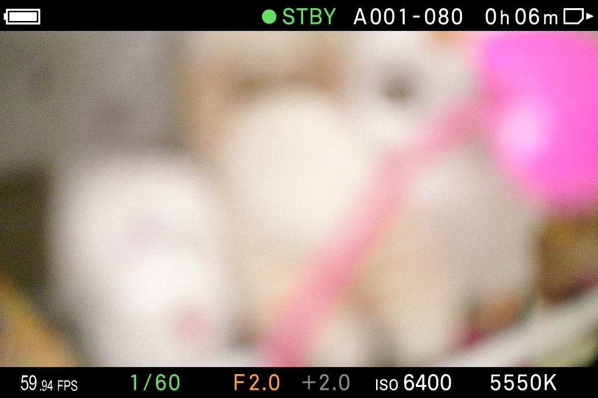

# FPS 整數／小數間距 — 2026-10-15

> 後續已部署向外加厚黑框的 fix12，保留本階段白字與間距。最新狀態見 [run7](../run7/RESULTS.md)；下面「目前卡上」描述 fix10 的歷史狀態。

目前卡上為 **combined-fix10**。保留 fix9 的字體、字級與黑色描邊，縮小整數到小數的空隙，並讓 FPS 隨小數接續。已開關 QS、逐次確認回到 `LV_CINE_MEDIUM` 後實拍，1941 完整顯示 **59.94 FPS**，其他原廠底列亦可見。

以原始 JPEG 的白字範圍量測，這次 59.94 的整數與小數點之間為 **7 個空白像素欄**，原廠 59.94 參考為 **6 欄**，相差 1 欄。前版 29.97 圖為 21 欄；它與這次的格率不同，不能把該圖寫成同格率前後對照。原廠 29.97 另有 7 欄的參考。完整座標、門檻與圖片見 `spacing-comparison.json`；初次誤標最新圖為 29.97 的 JSON 已標記拒用。這只驗收接續空隙，**不表示字形與原廠完全相同**。

## 修改範圍

原先按原廠圖片預估的每碼寬度，超過實際原生文字的 advance。中尺寸改按實拍的每碼 14 px 排列，只在整數後加一次 4 px 接續空間；29.97／59.94 的小數起點相較前版左移 14 px。小數文字框由 36 改為 27 px，避免把縮短的空白轉移到 FPS 前。大尺寸依相同原則按比例調整，尚未上機逐一確認。

字體、字級、15 個文字元件、黑邊位置、原物件與事件均保留。BIN 中 immutable core 程式碼與 fix9 完全相同，五份 RCD 逐位元組相同；只部署單一 `32RESCUS.BIN`。未送格率 setter，本次實際畫面為 59.94；設定區 bytes 32..128 保留。

## 成品與驗證

- Builder BIN：`../combined-fix10/32RESCUS.BIN`，250880 B，SHA-256 `994fdd37152301eaaa37939b7bc784fb161f2c83f9e6ec48e72eb4dad30ee057`。
- 含原設定的實際卡檔 SHA-256：`4009acafed5adf64949b19c8be161826e364f8110dc6e283498c7b45f63dddcb`；整檔讀回相符，見 `../deployment-combined-fix10.json`。
- CFG SHA-256：`be62abbe2254b1c884c280a4352039f677bf7128bd81eea87dfb30990e855640`。
- 建置：`python3 -B projects/open-gate/build/res-custom/build_v3_rescustom.py --out projects/res-lab/validation/20261015-qs-first-open/on-camera/combined-fix10`。AutoRun／loader 不需更新，未更換。
- `test_lv_text_style.StyleTests`：4 項通過，69.438 s，含四種版面的原廠 parser、文字／黑邊幾何、元件／動畫容量及未知資源拒絕。
- 實際保存 BIN 配目前卡 loader／AutoRun：371 個 QS 記錄、16 個 LV 替換、reader 資源登記旗標為 1、關機 journal 還原通過，見 `../combined-fix10-verification.json`。下層繪圖仍為 harness 替身。
- `final-state.json`：執行中 immutable code 相符；VR_UI=1、VR_WHY=1，十一個模組均 loaded／enabled、SupManager status=0、write_error=0。最後 CINE 非錄影待機，echo 與 GUI 診斷狀態已還原，socket owner PID 43701。

本輪只實拍 59.94／中尺寸 CINE LV，其他格率與大尺寸只有離線結構驗證。沒有錄影、十輪實體電源測試或發布。QS 首次等待未處理、未重新計時；[run4](../run4/RESULTS.md) 記錄的整條底列偶爾未出現在截圖的現象，也未在本輪宣稱修復。
