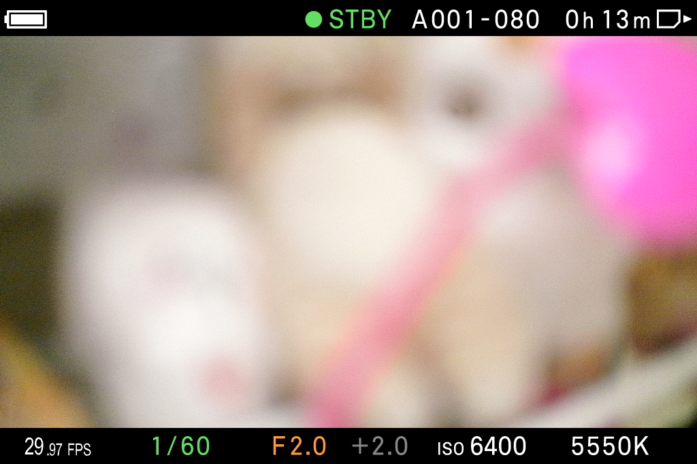

# FPS 黑框往外加厚至約 3 px — 2026-10-15

目前卡上為 **combined-fix12**。黑框往外延伸約 3 px，白字本身不加粗；保留 fix10 的字體、字級與數字間距。四種版面的三段白字記錄（除 component ID）及五條白字文字／位置曲線的全部 14 keys，均與 fix10 相同，見 `white-geometry-preserved.json`。

## 實拍驗證

先確認活動畫面，再開關 QS 更新。1942 可見完整 `29.97 FPS` 及原廠底部欄位；該次第二張中止是主機 runner 把 `target` 重複用於檔案路徑，造成畫面名稱與 Path 比較失敗，**不是相機切回 QS 的證據**。已將檔案變數改為 `destination`，後續對比色與最終黑色拍攝皆完整完成，且逐張保存結果。

為看清黑底上的外緣，只暫改自有 RAM 的描邊顏色，卡檔保持黑色。1943 對比色照片中，白字範圍 `[37,643,133,670]`，外緣範圍 `[34,640,136,673]`；四側均向外 **3 px**。這是 JPEG 顏色閾值的外接範圍，不能宣稱每個曲線位置都恰好等厚。照片與量測在 `edge-colour-proof/`、`outward-edge-measurement.json`。

驗證後完整讀回 126504 B 的 LV 表，確認 192 個跨四版面描邊副本均還原黑色，見 `edge-colour-restored-black.json`。再次開關 QS 後 1944 完整顯示 `29.97 FPS`，未殘留對比色。該圖其餘原廠底部資訊未出現；先前原廠對照也有整列／部分底列缺失的截圖，本輪未定位或宣稱修復該現象。字形仍不等於原廠圖片字形。

## 成品與界限

- Builder BIN：`../combined-fix12/32RESCUS.BIN`，313216 B，SHA-256 `d9a8e10050184424886afaca263279967ab2cc2c89314c44038fe4402a676355`。
- 含原設定的實際卡檔 SHA-256：`faa27b8f655f7a3c6b23be8c80cc288553c7993cf0f68a7a2bf95b0814c33cf7`；完整讀回相符，見 `../deployment-combined-fix12.json`。
- CFG bytes 32..128 保留，SHA-256 `be62abbe2254b1c884c280a4352039f677bf7128bd81eea87dfb30990e855640`。AutoRun、loader 與五份 RCD 不變；只換單一 BIN，不需更新 AutoRun。
- 原生物件／事件保留。每段白字先畫 16 個黑字副本，最後畫白字中心；合計 48 個黑字＋3 個白字、85 條動畫 property。元件 ID 唯一，白字為 3／56／57。
- 常駐表 16 entries、126504 B；build-time 與 runtime 上限同步為總表 0x20000 B、單資料 0x4000 B、51 records、512 string marks（實際文字曲線標記 476）。範圍、來源 hash、長度與字串 index 防護保留，沒有新增 hook 或更改設定 ABI。
- 建置：`python3 -B projects/open-gate/build/res-custom/build_v3_rescustom.py --out projects/res-lab/validation/20261015-qs-first-open/on-camera/combined-fix12`。

六項聚焦測試通過（85.263 s）：四個 StyleTests 含四版面原廠 parser／幾何／容量，加上未知記錄防護與 reader 資源登記旗標的兩個 core 回歸。實際保存 BIN 配目前卡 loader／AutoRun 的 371 個 QS 記錄、16 個 LV 替換與關機 journal 還原通過，見 `../combined-fix12-verification.json`。下層繪圖服務仍為 harness 替身，實際外觀另由以上照片驗收。

`final-state.json` 核對執行中 immutable code；VR_UI=1、VR_WHY=1，十一個模組均 loaded／enabled、SupManager status=0、write_error=0。檢查結束為非錄影 CINE 待機，echo 與 GUI 診斷旗標已還原，socket owner PID 44398。

實機範圍為 29.97／中尺寸 CINE LV，其他格率／大尺寸／STILLlike 尚未逐一實拍；沒有錄影、十輪實體電源測試或發布。QS 首次等待未重新計時、未解決；最後正式數據仍為 fix4 的 6.1161 s。2 px 中間版的離線與上機狀態保留在 [run6](../run6/RESULTS.md)。
